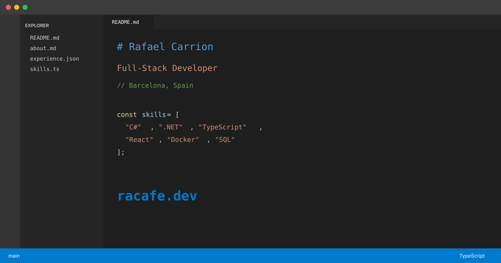

# rafaelcarrion.dev

A personal portfolio website styled as a VS Code IDE, built with Astro and Tailwind CSS.

## Features

- **IDE-Style Interface** - File explorer, tabs, syntax highlighting, and status bar
- **VS Code Dark+ Theme** - Faithful recreation of the classic color scheme
- **AI Chat Assistant** - Ask questions about Rafael's experience (powered by Gemini)
- **Mobile Responsive** - Collapsible sidebar and touch-friendly navigation
- **Easter Egg** - Try the Konami code for a surprise

## Preview



## Tech Stack

- [Astro](https://astro.build/) with SSR (Node.js adapter)
- [Tailwind CSS](https://tailwindcss.com/)
- [TypeScript](https://www.typescriptlang.org/)
- [Google Gemini API](https://ai.google.dev/)

## Getting Started

### Prerequisites

- Node.js 22.23.4+ (required by Astro 7)
- npm

### Installation

```bash
npm install
```

### Environment Variables

Create a `.env` file in the root directory:

```env
GEMINI_API_KEY=your_api_key_here
```

Optional variables:
```env
GEMINI_MODEL=gemini-1.5-flash
CHAT_RATE_LIMIT_SESSION=50
CHAT_RATE_LIMIT_IP_HOURLY=100
```

### Development

```bash
npm run dev
```

### Build

```bash
npm run build
npm run preview
```

### Format Code

```bash
npm run format
```

## Project Structure

```
src/
├── components/     # Astro components (ChatPanel, FileExplorer, etc.)
├── data/           # Resume data (single source of truth)
├── layouts/        # IDELayout wrapper
├── lib/            # Utilities (Gemini client, rate limiter)
├── pages/          # Routes and API endpoints
│   └── api/        # Server-side API routes
└── styles/         # Global CSS and Tailwind config
```

## License

MIT
